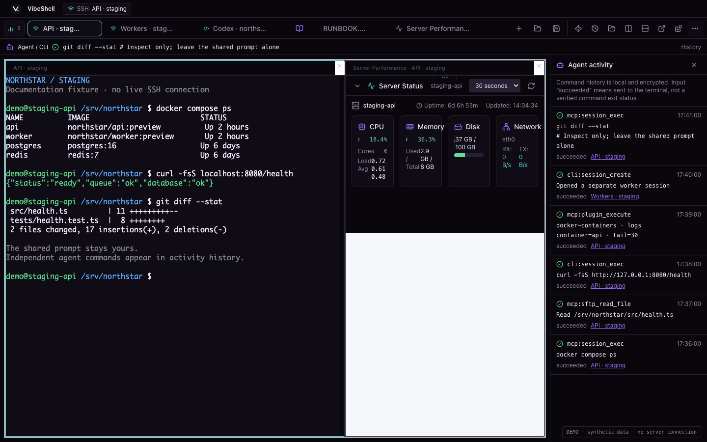
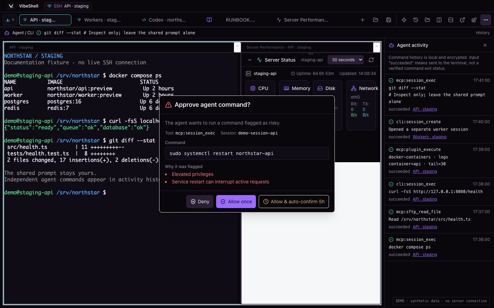
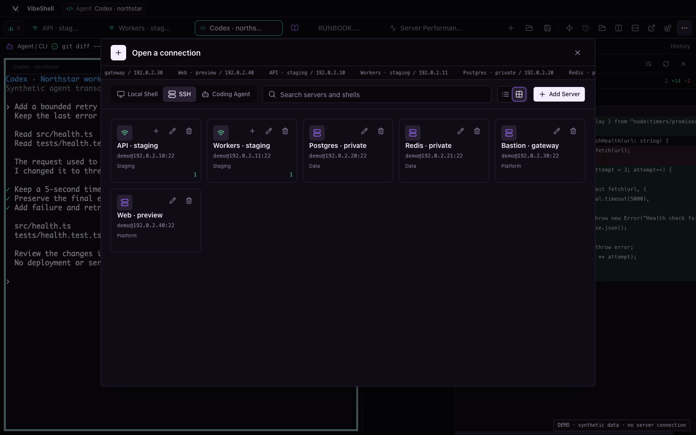

<div align="center">
  
  <h1>zxySSH</h1>
  <p><strong>连服务器、改文件、和 AI 一起做事，不必来回换地方。</strong></p>
  <p>一个自己用顺手、和 Agent 共用也看得明白的 SSH 工作区。</p>

  [English](README.md) · [简体中文](README.zh-CN.md) · [日本語](README.ja.md)

  [](https://github.com/opera163zuo/zxyssh/actions/workflows/ci.yml)
  [](https://github.com/opera163zuo/zxyssh/releases)
  [](LICENSE)

  [下载](https://github.com/opera163zuo/zxyssh/releases) · [Agent / CLI 指南](skills/zxyssh/SKILL.md) · [更新记录](CHANGELOG.md) · [参与开发](CONTRIBUTING.md)
</div>



*这些是实际 zxySSH 组件的截图，填入的是虚构 Northstar 项目数据。演示在隔离浏览器里运行，没有连接真实服务器、读取凭据、调用模型或重启服务。Agent 对话和命令结果是示例，不是一次真实 Agent 执行的录像。[复现截图](scripts/readme-demo/README.md)。*

## 少一点来回复制，多一点把事情做完

一次普通的服务器排错，往往不止敲几个命令：先看日志，再找配置，切到编辑器改两行，问一下 Agent，最后还要确认它操作的是哪台机器、哪个会话。

zxySSH 想把这些事放在一起。SSH 与本地终端共用一个标签工作区，旁边就是远程文件面板和本地文件编辑器。你可以把它当作普通终端；AI Agent 通过 MCP 服务访问同一批主机，而不是占用你的键盘。不使用 AI，并不妨碍日常终端和文件操作。

它的区别不在于重新发明 SSH，也不是宣称网络更快。用 OpenSSH、tmux、编辑器和脚本，同样能组合出很多能力。zxySSH 把它们之间的衔接做好，让你少配置、少复制、少丢上下文。

## AI 可以动手，你不用闭眼

### 它执行了什么，在哪个会话里，都能看到

桌面与 MCP 共用已保存的站点，Agent 只操作自己创建的会话。Agent 执行操作时，通知条和历史里会出现工具、Session、时间和状态。相同命令跑两次，留下两条记录；多行输入也能完整查看。

需要一起操作同一个提示符时，可以使用共享交互终端。不想打断你的输入时，让 Agent 独立执行检查命令，操作仍然出现在历史里。**“输入已发送”和“命令已完成”是两件事**，不会用一个含糊的成功提示混过去。

Agent 新开的会话会自动变成标签，但不会把你从当前标签拉走。同一服务器的两个连接也按 Session 分开管理。历史支持分页，重新打开 UI 后仍可读取。

### 要批准的是这条命令，不是一句“让我处理一下”

审批窗口直接展示准备执行的命令和需要确认的原因。你可以允许这一次，也可以拒绝，不必等看到输出才发现服务被重启了。MCP 工具调用遵守同样的权限与确认要求；没有审批界面的连接方式会直接拒绝需要确认的操作。



*图中只是演示请求，没有实际执行重启。命令识别和审批不是沙箱，也不代表所有风险都能被自动识别。*

### Agent 能做什么，边界写得很清楚

桌面是给人用的：从站点树连接、敲命令、传文件。同样的 SSH 能力通过 MCP 服务开放给 AI Agent，让另一台机器上的 Agent 也能操作这些主机，而它拿不到任何密码。

配对后的 Agent 只看到站点列表，以及自己创建的会话的输入与输出：

| Agent 能做什么 | 服务端的保护 |
| --- | --- |
| 列出站点、打开会话 | 只能按已保存站点名创建，且每个 Agent 得到自己的会话 |
| 发送按键、读取输出、调整终端大小 | 只能操作自己创建的会话 |
| 执行需要 root 的命令 | sudo 密码和精确命令白名单由人配置，Agent 看不到密钥 |
| 关闭自己的会话 | 拒绝 Agent 批量终止会话 |

超出这个范围的能力——任意 `exec`、远程文件搜索、SFTP 上传下载、修改站点配置——都不在配对 Agent 的接口里；调用被收回的工具会被直接拒绝。

## 小事情也顺手，没开 AI 也一样

只是忘了一个参数，不应该先打开聊天框。内置补全可以提示命令、子命令和选项，附带说明；行内提示和键盘可操作的列表就放在光标附近。


终端使用 xterm.js，在可用时使用 WebGL，并对输入和输出做批处理来减少界面开销。这些是为了交互响应，不是“让 SSH 带宽翻倍”的承诺。

## 找连接，不必先想 IP

站点树和启动器把 **SSH 与本地 Shell** 放在一起。搜索已保存的服务器，在紧凑列表和卡片之间切换，用嵌套分组整理环境。状态圆点标出已经连上的站点，单独的新会话入口让“回到刚才的工作”和“再开一个连接”更好区分。



内网目标可以配置跳板机，添加站点的同一个对话框里就能设置凭据、sudo 密码和 sudo 命令白名单。OpenSSH、PuTTY、Tabby 的档案读取器仍在代码里，但当前界面和 CLI 都没有导入入口：请从各自的工具导出后手动录入，或用 zxySSH 的同步导出恢复。第三方保存的密码本来也不会被复制过来，PuTTY `.ppk` 私钥需要先转换成 OpenSSH 格式。

换密码或私钥，也不必删掉服务器重建。编辑时，没动的字段保留原值，不把已有秘密读回表单；服务器资料和凭据一起保存，失败一起回滚。这里改的是 **zxySSH 保存的登录信息**，不是远端系统账号本身的密码。

## 文件就在会话旁边，本地文档也不例外

通过 SFTP 打开远程配置，或者按 **⌘/Ctrl+O** 打开本地文件，都能获得独立文件标签。本地文件不需要先建 SSH 连接；关掉最后一个终端，也不会把本地笔记一起关掉。

文本和代码可以编辑、语法高亮，Markdown 可以看源码、预览，或左右对照。SFTP 有分栏和图标浏览、多选、复制路径与上传下载进度，还可以查看支持的图片、PDF、媒体和归档。看手册、查日志、改配置，不用分别记住几个窗口的位置。

终端、文件和文档可以分屏、移动，文档也能放进独立窗口。调整布局不等于丢掉未保存内容；本地文本保存前会检查是否被其他程序改过，发现冲突就拒绝悄悄覆盖，截断读取也不会被当成完整文件保存。

目录传输同样重视“传对”：分块读写、写完才报下载完成、识别大小相同但内容不同的修改，删除多余文件时保护排除项和嵌套 `.gitignore`。比较内容可能多读一些远程数据，这是可靠性与流量的取舍。

[本地文件、Markdown 支持范围与编辑限制](docs/local-files-and-css-themes.md)

## 工作区按你的习惯来

**少管窗口，多留上下文。** 终端和文档可以分屏、重新排列、移到独立窗口，还能保存布局再回来。恢复布局不等于断掉的网络连接可以跨进程重启继续存在。

**长时间工作，也要舒服。** 明暗主题、跟随系统外观、终端字体与光标设置、键盘导航、减少动态效果都在。应用界面有英文和简体中文；日文 README 是文档翻译，不代表已有日文 UI。

**不只换几个颜色。** 自定义 CSS 支持即时预览、应用保存、导入导出和本地背景图片，可以改间距、圆角、文档排版。如果主题把按钮藏没了，**⌘/Ctrl+Shift+F12** 或原生菜单里的 *Disable Custom CSS* 可以停用它。只应用可信主题，CSS 里的远程 URL 也会产生网络请求。

[自定义 CSS 与恢复方法](docs/local-files-and-css-themes.md) · [主题起点](themes/vibecode-starter.css)

## 该有的 SSH 工具，没有丢

把监听地址从回环改为对外开放之前，先确认影响范围。


zxySSH 在认证前检查服务器身份，经过跳板时也验证实际目标；指纹变化会在登录前中止连接。凭据、sudo 密码和 Agent 操作历史采用本地加密存储，但不是 OS Keychain 托管，也不能抵挡已被攻陷的本机账户。私钥正确，并不是接受陌生服务器指纹的理由。

## Linux 服务器与跨平台 Agent

zxySSH 服务端面向 Ubuntu/Debian Linux 服务器。只要支持 MCP HTTP，Agent 可从不同操作系统远程连接；项目不提供 macOS 或 Windows 桌面版和原生 CLI 安装包。

[Linux 服务端与局域网 MCP 安装说明](docs/LAN-MCP-UBUNTU-DEBIAN.md) · [独立 CLI 说明](cli/README.md)

`zxyssh` 可执行文件只承担服务端本身和它的运维入口：启动监听、签发配对码、列出与撤销 Agent、处理无界面的主机密钥信任，以及把凭据留在本机。

```bash
zxyssh mcp serve                        # 启动监听（systemd Type=simple）
zxyssh mcp pair-code                    # 为下一个 Agent 签发一次性配对码
zxyssh mcp agents                       # 已配对 Agent 与撤销状态
zxyssh mcp credential set my-server     # 凭据从管道 stdin 读入
zxyssh mcp hostkey probe my-server      # 连接前的无界面 TOFU
```

局域网监听需要明确写出绑定地址，并显式设置 `ZXYSSH_MCP_ALLOW_LAN=true`；在没有任何已配对 Agent 时拒绝启动。不要把密码或私钥写进命令行参数或 Agent 提示词。

桌面与服务端在同一 Linux 用户下共用一个数据库，因此在界面里添加的站点就是 Agent 能使用的站点。连接依赖实际持有它的进程：服务端持有的会话可以在 GUI 关闭后继续，GUI 自己持有的连接则会随该进程退出而结束。升级时应让桌面与 CLI 保持一致，重启前保存正在做的工作。

zxySSH 桌面包和原生 CLI 仅面向 Linux 发布，移动端代码路径已删除而不是留着不测；常见 OpenSSH 测试仍不能覆盖每一种 MFA、硬件令牌或 SSH 实现。

## 自己运行，或者参与开发

项目使用 Tauri 2、Rust、React、TypeScript 和 xterm.js。开发需要 Node.js 22.12+、当前稳定 Rust，以及系统对应的 [Tauri 前置依赖](https://v2.tauri.app/start/prerequisites/)。

```bash
git clone --branch dev https://github.com/opera163zuo/zxyssh.git
cd zxyssh
npm ci
npm run tauri -- dev
```

提交前运行 `node scripts/check-release.mjs`、`npm test`、`npm run build`、`cargo fmt --all -- --check`、`cargo clippy --workspace --all-targets --locked -- -D warnings` 和 `cargo test --workspace --locked`。SSH 变更还可运行仅绑定回环地址的 Docker 夹具：`bash scripts/test-ssh-compatibility.sh`，不要拿自己的真实凭据库做回归测试。

**普通 PR 一律先到 `dev`。** `main` 只接受本仓库 `dev` 的发布晋级。构建代码不等于允许覆盖正在使用的应用或结束别人的 SSH 会话。

CI 构建和发版都改为**手动触发**：维护者在合并前对 PR 的最新提交手动运行 CI，推送代码或版本标签不会编译或发布。Release 必须从 `main` 运行，默认只生成草稿，明确勾选发布才会公开。必需检查、签名和完整源码校验仍然保留。

Docker 清单改进以及容器独立会话、出站代理的剩余工作见[九月 issue 审查](docs/ISSUE_TRIAGE_2026-09.md)。容器列表命令不等于持久容器会话；zxySSH 已随隧道运行时一起移除端口转发能力，出站代理仍需单独设计，不能挂在转发监听上。

[贡献指南](CONTRIBUTING.md) · [架构](AGENTS.md) · [发布流程](docs/RELEASING.md) · [协作接口](docs/AGENT_COLLABORATION.md)

安全问题请走 [私密报告](https://github.com/opera163zuo/zxyssh/security/advisories/new)，不要在 Issue 里贴真实凭据。审批不是沙箱，敏感输入保护也不能阻止远端程序回显；响应丢失后，不应自动重放可能已执行的修改命令。

## 许可证

zxySSH 自 1.1.0 起整体采用 **GPL-3.0-only**。参见 [LICENSE](LICENSE)、[NOTICE](NOTICE) 和 [保留的 MIT 声明](licenses/legacy-MIT.txt)。旧 MIT 授权不追溯撤销，第三方组件保留自己的许可证；发布下载提供对应源码及声明。在法律允许范围内，软件不提供担保。
